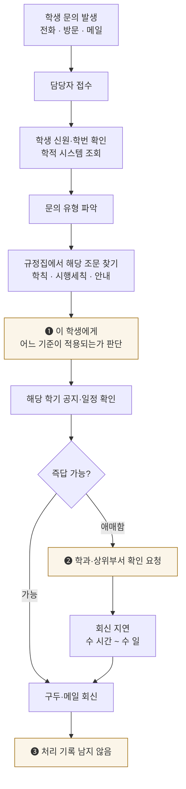
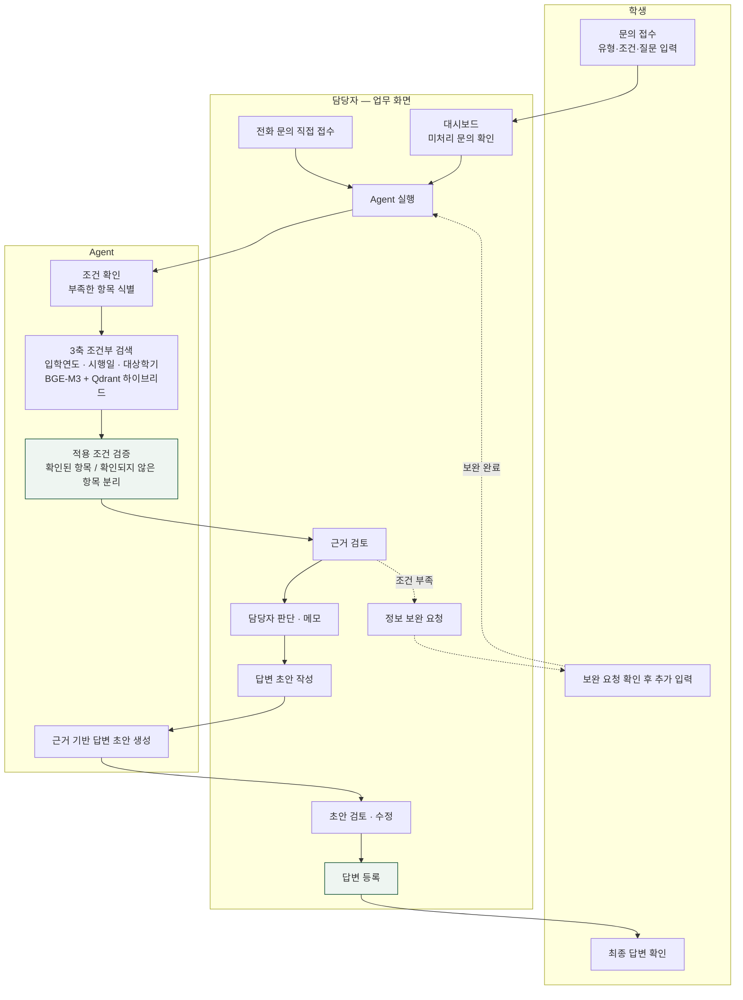

# Workflow 정의 — AI 적용 전 / 후

과제 요구사항 *"Workflow 정의 (AI 적용 전후 비교) — flowchart로 그려서 보여주기"* 에 해당합니다.
아래 흐름은 **실제 구현된 시스템**(백엔드 0.6.0 + 학생·담당자 화면)을 기준으로 작성했습니다.

---

## 1. 업무 대상

학사 행정 담당자가 처리하는 **학생 학사 문의**입니다.

과제 안내의 자동화 대상 조건에 그대로 해당합니다.

| 조건 | 이 업무에서 |
|---|---|
| 반복적이고 시간이 많이 소요 | 같은 유형의 문의가 학기마다 반복 |
| 인적 오류가 발생하기 쉬운 데이터 집약적 작업 | 학칙·시행세칙·공지·교육과정을 사람이 대조 |
| 예측 가능한 질문과 답변으로 구성 | 졸업요건·과목인정·휴복학이 대부분 |
| 프로세스가 명확하고 표준화 | 접수 → 근거 확인 → 판단 → 회신 |

**이 업무가 어려운 이유는 자료가 많아서가 아니라, 같은 질문의 답이 학생마다 다르기 때문입니다.**
입학연도·학과·전공 구분에 따라, 그리고 규정이 언제 개정되었는지에 따라 적용 기준이 갈립니다.

---

## 2. AI 적용 전 (As-Is)

### 병목

| # | 지점 | 문제 |
|---|---|---|
| ❶ | 적용 기준 판단 | 조문을 찾는 것보다 **"이 학번에게 어느 버전이 적용되는가"** 를 가리는 데 시간이 든다. 틀리면 비용이 크다 |
| ❷ | 부서 간 확인 | 한 건이 며칠씩 늘어진다 |
| ❸ | 기록 부재 | 같은 문의가 다시 와도 처음부터 다시 한다. 판단 근거가 남지 않는다 |

> **실제 사례**: 이화여대 컴퓨터공학은 2024년 학제개편으로
> *엘텍공과대학 소프트웨어학부 컴퓨터공학전공* → *인공지능대학 컴퓨터공학과* 로 소속이 바뀌었습니다.
> 2022학번과 2025학번은 소속도 교육과정도 다릅니다. ❶이 어려운 이유가 이것입니다.

---

## 3. AI 적용 후 (To-Be)

### 핵심 설계

- **최종 판단과 회신은 항상 담당자가 합니다.** 시스템은 학생에게 직접 회신하지 않습니다
- **자료에서 확인되지 않은 항목을 불가 판정으로 바꾸지 않습니다.** 확인되지 않았다는 사실 그대로 표시합니다
- 근거가 충분하지 않으면 답을 만들어내지 않고 **확인이 필요한 항목**을 제시합니다
- 모든 답변에 **원문 근거**와 **실행 기록**이 붙습니다

---

## 4. 전후 비교

| 구분 | As-Is | To-Be |
|---|---|---|
| 접수 경로 | 전화·방문 (근무시간 한정) | 웹 접수 24시간 + 전화 접수 등록 |
| 자료 탐색 | 담당자가 규정집·공지를 직접 대조 | 3축 조건부 검색으로 후보 제시 |
| 적용 기준 판단 | 담당자 기억·경험에 의존 | 입학연도·시행일·대상학기를 분리해 대조 |
| 근거 제시 | 구두, 추적 불가 | 원문 인용 + 출처 링크 |
| 불확실할 때 | 부서 확인 후 회신 지연 | 확인 필요 항목을 특정해 제시 |
| 최종 책임 | 담당자 | **담당자 (변화 없음)** |
| 기록 | 남지 않음 | 접수·근거·판단·답변·시각 모두 저장 |
| 재문의 대응 | 처음부터 다시 | 이전 처리 내역 조회 |

### 측정 지표 (발표용)

직접 측정 가능한 것만 적습니다. 추정치는 가정을 함께 밝힙니다.

| 지표 | 측정 방법 |
|---|---|
| 1건 처리 시간 | 접수(`created_at`) → 완료(`completed_at`) |
| 근거 확보율 | run 결과에 evidence가 있는 비율 |
| 보완 요청 비율 | `waiting_student` 로 전환된 비율 |
| 자동화 범위 | 전체 문의 중 추가 부서 확인 없이 완료된 비율 |

> **주의**: 담당자용 시스템이므로 **학생의 대기 시간이 직접 줄어든다고 단정하지 않습니다.**
> 담당자의 1건 처리 시간이 줄어들어 **간접적으로** 회신이 빨라지는 구조입니다.

---

## 5. 역할 분담과 협업

| | 담당 | 브랜치 |
|---|---|---|
| 한준 | 자료 수집·선별, 구조화, VectorDB 적재 | `snsrhoeho` → `feat/ingest-pipeline` |
| 현선 | 백엔드·Agent·학생 화면, 배포 | `backend`, `frontend/student` |
| 기훈 | 선행연구·업무 정의, 담당자 화면 | `docs/*`, `frontend/staff` |

Git merge log는 발표 시 `git log --merges` 로 공개합니다.
